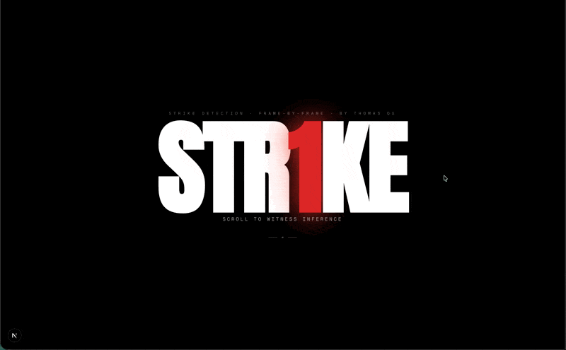

# Strike | MMA Strike Attempt Detection

**Live demo: [strike.thomasou.com](https://strike.thomasou.com)**

A research pipeline for labeling and detecting strike attempts in MMA footage, including blocked and missed strikes.



The current dataset is a pilot, not a generalization benchmark. It contains 38 five-frame clips and 190 frames. Both historical test clips also occur in validation; fight IDs and timestamps were not recorded. There is no independent test result yet. The showcase distinguishes recorded notebook metrics, saved checkpoint predictions, and illustrative figures.

## Quick Start

Python 3.11. Run from the repository root:

```bash
uv venv --python 3.11
uv pip install --python .venv/bin/python -r model/requirements.txt
source .venv/bin/activate
```

Keep footage outside Git. Existing private data uses `annotations/{train,val,test}.txt` and `frames/{strike,neutral}/<id>/img_00001.jpg` through `img_00005.jpg`.

```bash
python -m model.data import-legacy --data-root /path/to/str1ke/data --output data-local/legacy.json
python -m model.data audit --manifest data-local/legacy.json --data-root /path/to/str1ke/data --development --output runs/legacy-audit.json
```

Import assigns every legacy clip to **development**, retains its old split memberships, and leaves unknown provenance empty. It does not relabel old examples as reviewed strike attempts or manufacture a fresh test set.

Use new output paths for imports, audits, runs, and comparisons. Existing files are refused so an output-path mistake cannot replace source frames or prior results.

For a pipeline smoke run on that data:

```bash
python -m model.train --manifest data-local/legacy.json --data-root /path/to/str1ke/data --output runs/legacy-smoke --development --epochs 2
```

This reports training-set diagnostics only. The first pretrained run downloads the public ImageNet ResNet-50 weights. No clips are uploaded.

## Data and Evaluation

Use the [manifest schema and labeling rules](PROJECT_OVERVIEW.md) to curate new footage. Assign entire fights to train, validation, or test **before extracting windows**. Keep an untouched test set from other fights; all previously inspected clips remain development data.

```bash
python -m model.data audit --manifest data-local/reviewed.json --data-root /path/to/frames --output runs/data-audit.json
python -m model.train --manifest data-local/reviewed.json --data-root /path/to/frames --output runs/raw --variant raw
python -m model.train --manifest data-local/reviewed.json --data-root /path/to/frames --output runs/masked --variant masked
python -m model.compare --raw runs/raw --masked runs/masked --split validation --output runs/validation-comparison.json
```

The masked run requires a corresponding masked frame for every raw frame. Both runs use the same manifest, seed, training settings, preprocessing, and code. Each selects its checkpoint using validation loss. Training never evaluates test clips.

After freezing the experiment design:

```bash
python -m model.evaluate --run runs/raw --manifest data-local/reviewed.json --data-root /path/to/frames
python -m model.evaluate --run runs/masked --manifest data-local/reviewed.json --data-root /path/to/frames
python -m model.compare --raw runs/raw --masked runs/masked --split test --output runs/test-comparison.json
```

If evaluation used a custom `--output`, pass that directory to comparison with `--raw-evaluation` or `--masked-evaluation`. Both evaluation and comparison check the checkpoint against the original training record.

Each run saves configuration, dataset and source hashes, environment versions, epoch history, a checkpoint, per-clip probabilities, and overall/per-fight metrics. Reports include precision, recall, F1, balanced accuracy, average precision, log loss, Brier score, and a confusion matrix. Undefined metrics are `null`, not a misleading zero. A comparison reports changed predictions and descriptive differences; it does not claim statistical significance from correlated clips.

## Annotation Workspace

Open http://localhost:2100/workspace with the showcase running. Choose a local video and enter a stable fight ID. Mark short windows as attempt, no attempt, or uncertain; misses and blocks are attempts. Record outcomes and notes separately. Use `I` / `O` for in/out points, `1` / `2` / `3` to label, `N` for a new window, and arrow keys to seek by 0.1 seconds.

Annotations save in IndexedDB after each change. Videos are neither uploaded nor stored in the browser database; reconnect the original file after reloading. A streamed SHA-256 check prevents attaching different footage with the same filename. Export JSON backups to move work between browsers or preserve it outside browser storage. Concurrent edits from another tab are refused instead of overwriting newer work.

Export your annotation backup, then prepare frames and run an existing raw checkpoint:

```bash
python -m model.prepare --annotations annotations.json --video /path/to/footage.mp4 --output data-local/reviewed
python -m model.predict --prepared data-local/reviewed --run runs/legacy-smoke --output runs/workspace-review
```

Replace `runs/legacy-smoke` with the completed model run you want to inspect. Import `runs/workspace-review/predictions.json` into the workspace. Its review queue can filter disagreements with your labels. Predictions never overwrite annotations, and editing window boundaries invalidates their old scores.

Preparation uses PyAV's bundled FFmpeg libraries; no system FFmpeg install is needed. It samples five distinct, ordered source frames inside each interval, records their presentation timestamps and hashes, and checks the generated manifest. Intervals containing fewer than five frames are refused. Use zero-start video timelines; unsupported timestamps or display transforms require re-encoding and labeling the corrected file. Variable frame rates are supported through recorded presentation timestamps, not an assumed frame rate.

`review.json` retains every window. `manifest.json` includes only attempt/no-attempt labels, all assigned to development; uncertain and unlabeled windows are excluded. If no windows have definitive labels, no training manifest is written. Prediction can still score those windows for review. These are window labels and diagnostic scores, not unique strike counts or independent benchmark results.

## Baseline

The new baseline freezes an **ImageNet-1K ResNet-50**, averages features across five frames, and trains a two-class linear head. Frozen batch normalization stays in evaluation mode. Frame preprocessing is identical during training and evaluation.

This is an **appearance baseline**: averaging is insensitive to frame order. It can recognize poses and visual context but does not explicitly model strike motion. SAM2 masking is an experiment to compare against raw footage, not an established improvement. Five frames are a modeling choice, not a guarantee that the whole attempt fits inside a window.

The original MMAction2 and 3D-CNN notebooks remain unchanged as historical artifacts. The saved TSN run loads ImageNet weights, records no Kinetics checkpoint initialization, and ends at 50% validation accuracy on six clips. Its earlier 100% validation epochs are not evidence of unseen-fight performance.

## Showcase

```bash
cd showcase
npm ci
npm run dev
```

Open http://localhost:2100. The demo at `/demo` plays recorded checkpoint predictions on the displayed frames; their accuracy has not been measured. The research report labels its illustrative figures separately. The workspace at `/workspace` reviews local footage and imports saved model scores; new inference runs locally in Python.

Regenerate the historical chart from saved notebook output:

```bash
python model/export_notebook_history.py
```

## Tech Stack

| Layer | Tools |
|---|---|
| Data audit | Python, Pillow, SHA-256 manifests |
| Baseline | PyTorch, torchvision, frozen ResNet-50 |
| Masking experiments | Paired precomputed frames; existing SAM2 tooling |
| Historical experiments | MMAction2 TSN, 3D-CNN notebooks |
| Showcase | Next.js, TypeScript, Tailwind CSS |

## Project Structure

```text
model/
  data.py                    # Import, provenance checks, leakage audit
  baseline.py                # Encoder, preprocessing, metrics
  train.py                   # Seeded training and checkpoint selection
  evaluate.py                # Separate test evaluation
  compare.py                 # Paired raw/masked comparison
  annotations.py             # Workspace export validation
  prepare.py                 # Timestamped video extraction
  predict.py                 # Saved-checkpoint review scores
  export_notebook_history.py # Recorded historical chart, with source hash
  notebooks/                 # Original experiments
showcase/                    # Research report, recorded demo, and annotation workspace
PROJECT_OVERVIEW.md          # Labeling and manifest reference
```

Built by Thomas Ou
