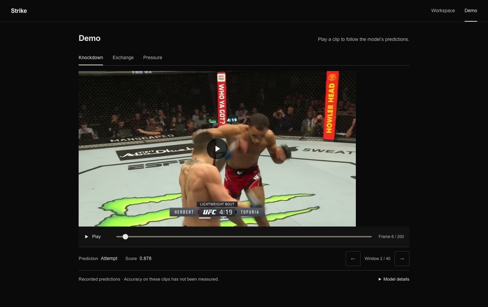

# Strike | Strike Attempt Classification

**Live demo: [Recorded predictions](https://strike.thomasou.com/demo) · [Annotation workspace](https://strike.thomasou.com/workspace)**

I built Strike to study whether short video windows can identify MMA strike attempts and whether masking the background changes the result.

## Start Here

Open [Research_Notes.ipynb](model/notebooks/Research_Notes.ipynb). It contains the label definition, historical training results, current baseline, recorded predictions, and executable checks of the saved artifacts. The saved outputs can be read without installing anything.

The evidence is a 38-window pilot and recorded development predictions. **Accuracy on unseen fights has not been established, and there is no measured raw-versus-masked result.**

[Check saved artifacts](#check-the-saved-artifacts) · [Run an experiment](#run-a-new-experiment) · [Data protocol](PROJECT_OVERVIEW.md)

## Question and Method

The target is a **strike attempt**, including a blocked or missed punch, kick, knee, or elbow. Contact is a separate annotation. Uncertain windows stay outside the binary training labels.

The current [appearance baseline](model/baseline.py) freezes an ImageNet ResNet-50, averages the feature vectors from five frames, and trains a two-class linear head. Frames are resized to a 256-pixel short edge, center-cropped to 224 pixels, and normalized with ImageNet statistics. Averaging discards frame order, so this baseline does not explicitly model motion direction or timing.

The experiment code supports raw and masked inputs from the same windows. A controlled comparison requires matching fight assignments, labels, seed, preprocessing, and training settings. Checkpoint selection uses validation loss; reserved test fights are evaluated separately. The [data protocol](PROJECT_OVERVIEW.md) defines the manifest, annotation rules, leakage checks, and comparison procedure.

## What the Saved Runs Show

The historical MMAction2 TSN run is separate from the current frozen-backbone baseline. Its [exported logs](showcase/src/lib/legacy-training.json) record the following at epoch 20:

| Historical partition | Windows | Accuracy |
| --- | ---: | ---: |
| Training | 30 | 100% |
| Validation | 6 | 50% |
| Independent test | — | Not recorded |

Validation accuracy was 100% at epochs 1 and 2, also on just six windows. Both clips called “test” in the original annotation files also appear in validation. The collection has 38 distinct windows, with two outside those partitions; its old labels need review against the current attempt definition. These results do not estimate performance on new fights.

The [recorded demo export](showcase/src/lib/recorded-demo.json) comes from a separate frozen-ResNet development checkpoint trained on the 38 pilot windows. It contains 120 scored windows across three sequences, with hashes for all 600 displayed frames. Those sequences have no reviewed ground-truth labels or benchmark metrics. The scores are uncalibrated, and threshold crossings are not counts of individual strikes.

## Check the Saved Artifacts

Clone the repository, then run the notebook's verification cells from the repository root with Python 3.11 or later:

```bash
git clone https://github.com/Smokeybear10/100.RSCH.strike.git
cd 100.RSCH.strike
python3 - <<'PY'
import json
from pathlib import Path

notebook = json.loads(Path("model/notebooks/Research_Notes.ipynb").read_text())
namespace = {}
for index, cell in enumerate(notebook["cells"]):
    if cell["cell_type"] == "code":
        exec(compile("".join(cell["source"]), f"cell-{index}", "exec"), namespace)
PY
```

This uses only the Python standard library. It checks the historical notebook fingerprint and exported metrics, verifies the 600 frame hashes and 120 window records, and prints the saved summaries. It does not download data, write files, rerun neural inference, or measure prediction accuracy.

The original [TSN](model/notebooks/TSN_Pipeline.ipynb) and [3D-CNN](model/notebooks/3DCNN_Pipeline.ipynb) notebooks are retained as experiment records. The historical TSN notebook uses a personal Drive path; its original training environment and inputs are not a self-contained reproduction. Trained checkpoints and source videos are not included.

## Run a New Experiment

Use Python 3.11. Install the pinned [model dependencies](model/requirements.txt) from the repository root:

```bash
python3.11 -m venv .venv
source .venv/bin/activate
python -m pip install -r model/requirements.txt
```

These commands require your own reviewed manifest and frames following [PROJECT_OVERVIEW.md](PROJECT_OVERVIEW.md). Assign entire fights, including replays, to train, validation, or test. Workspace exports are development data; they do not provide an untouched test set.

```bash
python -m model.data audit --manifest data-local/reviewed.json --data-root /path/to/frames --output runs/data-audit.json
python -m model.train --manifest data-local/reviewed.json --data-root /path/to/frames --output runs/raw --variant raw
```

The default run uses CPU, seed 42, and 20 epochs. ImageNet weights download on first use. The run saves its configuration, dataset audit, training history, selected checkpoint, and per-window validation predictions. Use new output paths for each experiment.

After freezing the design and model choice, evaluate the reserved test fights:

```bash
python -m model.evaluate --run runs/raw --manifest data-local/reviewed.json --data-root /path/to/frames
```

Results are written to `runs/raw/evaluation/test_metrics.json` and `test_predictions.csv`, including per-fight metrics. The notebook has the preparation and prediction-import commands; [compare.py](model/compare.py) checks paired raw/masked runs. None of these commands supplies the missing independent dataset or turns the historical pilot into a benchmark.

## Review Footage

The browser workspace labels local footage, saves annotations in IndexedDB, and exports JSON backups. Videos stay on the device and must be reconnected after reloading. Saved model scores can be imported without replacing human labels. Inference runs separately in Python.



To run the workspace and recorded demo locally:

```bash
cd showcase
npm ci
npm run dev
```

Open http://localhost:2100. `/` opens the workspace; `/demo` plays the committed predictions. See [showcase/README.md](showcase/README.md) for frontend checks.

## Limits

The pilot lacks complete fight identities and source timestamps. Neighboring windows are correlated, the old validation and test memberships overlap, and the displayed demo footage has no reviewed labels. More windows from those sequences would not establish generalization.

The current task classifies windows. It does not establish landed-strike counts, fighter attribution, event boundaries, calibrated probabilities, or the benefit of segmentation. Answering the original question requires reviewed examples from separate fights and a matched raw/masked evaluation on reserved footage.

## License

Original code and documentation are available under the [MIT License](LICENSE). Third-party artwork, broadcast-derived demo media, dependencies, datasets, and pretrained weights retain their own terms; see [third-party notices](THIRD_PARTY_NOTICES.md).

Local checks and commit conventions are in [CONTRIBUTING.md](CONTRIBUTING.md).

Built by Thomas Ou
